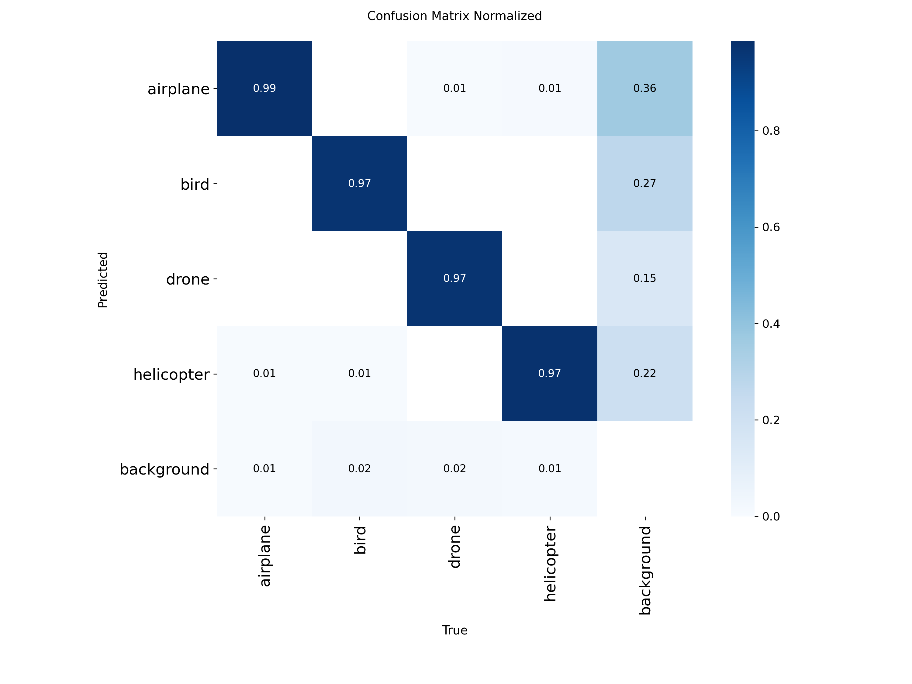
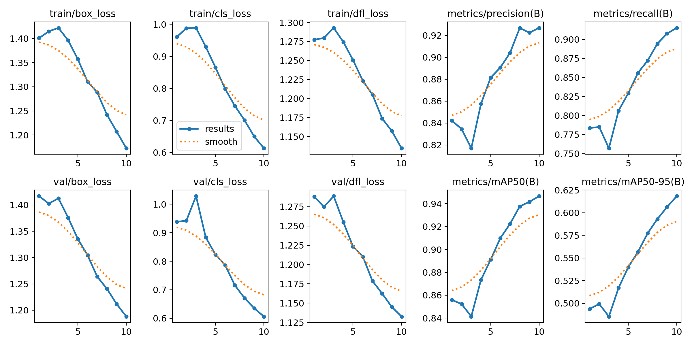

# Project-ai-computer-vision-objects
Object detection for airplanes, birds, drones and helicopters with YOLO11 (Computer Vision project, Factoria F5 Madrid).
# AeroVision AI

Detección de aviones, aves, drones y helicópteros en imágenes y vídeo con YOLO11n.

Proyecto de visión por computador del Bootcamp de IA de Factoría F5 Madrid.

## Objetivo

Entrenar un modelo de detección de objetos que localice y clasifique cuatro tipos de objetos aéreos: avión (`airplane`), ave (`bird`), dron (`drone`) y helicóptero (`helicopter`). El modelo dibuja una caja alrededor de cada objeto y muestra su clase y el porcentaje de confianza.

## Dataset

AOD 4, publicado en Mendeley Data (identificador `cd5z895tr2`): 22.516 imágenes de 1024x1024 píxeles, en formato YOLO.

| Partición | Imágenes |
|---|---|
| train | 15.761 |
| valid | 4.514 |
| test | 2.241 |

Las cuatro clases están equilibradas en número de objetos. El orden de las clases es: `0` airplane, `1` bird, `2` drone, `3` helicopter.

## Tecnologías

- **Python** como lenguaje.
- **Ultralytics YOLO11n** (modelo `nano`, 2,6 millones de parámetros) para la detección de objetos.
- **PyTorch** como framework de aprendizaje profundo.
- **Google Colab** (GPU Tesla T4) y **Google Drive** para entrenar y guardar los resultados.
- **Docker** para ejecutar el detector en cualquier equipo sin instalar dependencias a mano.

## Metodología

1. Aprendizaje por transferencia: se parte de `yolo11n.pt`, preentrenado con COCO, y se reentrena con las cuatro clases del dataset. El entrenamiento se continuó en sesiones sucesivas; la última añadió 10 épocas.
2. Imágenes reescaladas a 640x640 y normalizadas entre 0 y 1.
3. Aumento de datos aplicado por Ultralytics durante el entrenamiento: volteo horizontal, variaciones de color (HSV), escala y traslación.
4. Evaluación final sobre el conjunto de test, que no se usó para entrenar ni para decidir cuándo parar.

## Resultados en test

| Clase | Precisión | Recall | mAP50 | mAP50-95 |
|---|---|---|---|---|
| Todas | 0,924 | 0,915 | 0,949 | 0,627 |
| airplane | 0,920 | 0,939 | 0,968 | 0,690 |
| bird | 0,919 | 0,896 | 0,939 | 0,634 |
| drone | 0,949 | 0,910 | 0,950 | 0,601 |
| helicopter | 0,908 | 0,915 | 0,939 | 0,583 |

- **Precisión:** de lo que el modelo detecta, qué proporción es correcta.
- **Recall:** de los objetos reales, qué proporción encuentra el modelo.
- **mAP50:** precisión media contando una detección como correcta si su caja solapa al menos un 50 % con la real.
- **mAP50-95:** la misma métrica con solapes cada vez más exigentes (de 0,50 a 0,95). Mide también lo bien ajustada que está la caja al objeto.

Los resultados en test son casi idénticos a los de validación (mAP50 0,947 y mAP50-95 0,619), lo que indica que el modelo no está sobreajustado. La inferencia tarda unos 4 ms por imagen en una GPU T4.





## Estructura del repositorio

```
.
├── notebooks/      Cuaderno de Colab con todo el flujo (preparación, entrenamiento, evaluación)
├── src/            Script de predicción por línea de comandos
├── models/         Pesos entrenados (best.pt)
├── results/        Gráficas de evaluación
├── Dockerfile
├── requirements.txt
└── README.md
```

## Uso

### Con Docker

Es la forma recomendada: no hace falta instalar Python ni las librerías. La imagen usa solo CPU.

```bash
docker build -t aerovision-ai .
docker run --rm \
  -v "$(pwd)/media:/data" \
  -v "$(pwd)/outputs:/app/outputs" \
  aerovision-ai --source /data/mi_video.mp4
```

En Windows con PowerShell, sustituye `$(pwd)` por `${PWD}`. El resultado se guarda en `outputs/predictions`. Ultralytics guarda los vídeos con extensión `.avi`.

### Con Python

```bash
pip install -r requirements.txt
python src/predict.py --source media/mi_imagen.jpg
```

Opciones principales: `--weights` (ruta a los pesos), `--conf` (confianza mínima, 0,25 por defecto), `--imgsz` (tamaño de imagen, 640 por defecto) y `--device` (`0` para GPU, `cpu` para CPU).

## Limitaciones

- El modelo solo distingue cuatro clases. Ante un avión de cualquier aerolínea responde `airplane`; no identifica la compañía ni el modelo de aeronave. Tampoco distingue especies de aves.
- Se entrenó con la variante más ligera de YOLO11 y con un número reducido de épocas por el límite de GPU de Colab. La métrica seguía mejorando al terminar, así que más épocas o un modelo mayor (YOLO11s o YOLO11m) mejorarían los resultados.
- El mAP50-95 (0,627) es bastante menor que el mAP50 (0,949): el modelo encuentra los objetos, pero las cajas no siempre se ajustan con la máxima precisión.
- En las pruebas se observó al menos un helicóptero grande sin detectar.
- Las imágenes del dataset proceden de un número limitado de escenarios, por lo que el rendimiento con fotografías y vídeos propios puede ser menor.

## Trabajo futuro

- Añadir clases propias (aerolíneas, especies de aves, otros tipos de drones) con un dataset anotado específico, o un segundo modelo clasificador que se aplique al recorte de cada avión detectado.
- Aplicación que registre llegadas y salidas de aviones a partir de vídeo.
- Interfaz web con Streamlit.

## Autoría

Gisella Cuesta ([@gisegithut](https://github.com/gisegithut)). Bootcamp de IA, Factoría F5 Madrid.

